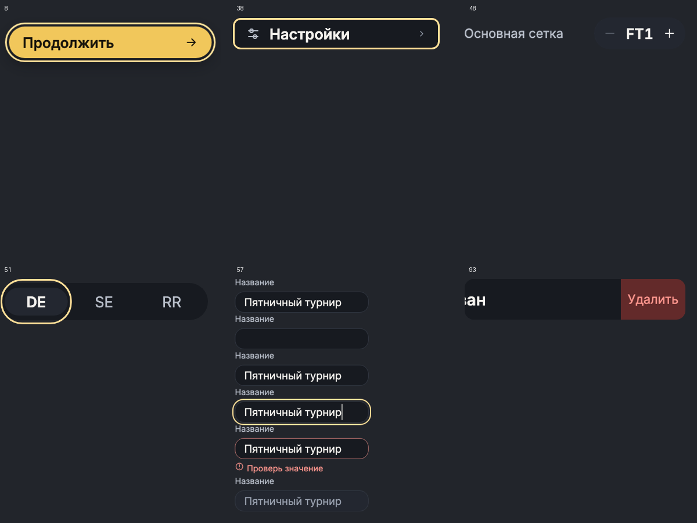

# Widgetbook viewport audit — 8 ноября2026

Проверены все101 registered use cases в настоящем Widgetbook appBuilder/ViewportAddon: Mobile390×844 и Desktop1440×900. Native macOS Flutter renderer, DPR1, text scale1 и1.6. Test-only RepaintBoundary сохраняет исходные constraints. Отчёт содержит геометрию public DS widgets и Flutter layout exceptions; screenshot review дополняет автоматические проверки.

## Исправления
- Colors: карточки палитры имеют minimum height и растут с текстом, устраняя RenderFlex overflow.
- NumberStepper: FT output измеряется по текущей теме/textScaler, остаётся одной строкой.
- Button: removeSwipe ширина растёт по localized label; baseline minimum88 сохранён.
- RosterRow: reveal ширина совпадает с ButtonTheme, действие занимает всю высоту у правого края.
- Borders, NavigationItem, SegmentedChoice, Field: theme inset16 в Widgetbook сохраняет внешний focus outline внутри viewport; production geometry не изменена.

Каждый компонент сохранён отдельным локальным коммитом. Push не выполнялся.

## Повторение
Из apps/tournament_app:
```sh
flutter test --no-pub test/widgetbook_viewport_audit_test.dart
flutter test --no-pub --dart-define=WIDGETBOOK_AUDIT_TEXT_SCALE=1.6 test/widgetbook_viewport_audit_test.dart
```
Для PNG/JSON добавить `--dart-define=WIDGETBOOK_AUDIT_DIR=/tmp/widgetbook-audit`. Для одного пути добавить `--dart-define=WIDGETBOOK_AUDIT_FILTER=components/field`.

[Scaled Mobile geometry](widgetbook-viewport-audit/scaled-390.json) · [Scaled Desktop geometry](widgetbook-viewport-audit/scaled-1440.json)



## Границы проверки
Все зарегистрированные начальные состояния; интерактивные контракты покрываются owning component tests. Полноэкранные Scaffold и прокручиваемые галереи намеренно занимают viewport. Большая доступная desktop ширина сама по себе не дефект. Проверка не является pixel-perfect сравнением с HTML и не заменяет source comparison. Windows/Linux/native mobile не запускались.

## Итоговые проверки
404 renders без layout exceptions;94 DS/Widgetbook tests PASS; flutter analyze no issues; architecture328 файлов PASS; checker regression49+51+35 PASS. Source comparison NumberStepper/RosterRow PASS. macOS Widgetbook пересобран и запущен.
